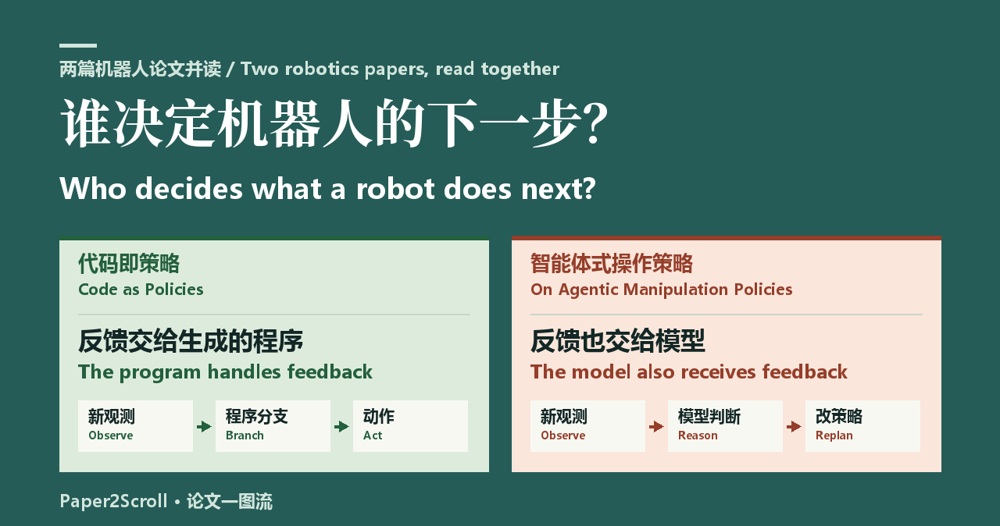

# Paper2Scroll

**Read a research paper in one scroll.**

Paper2Scroll turns research PDFs into vertical infographics that explain the argument, framework, method, and findings. Key claims point back to the paper’s sections, figures, or tables.

[简体中文](README.zh-CN.md) · [See the example](#example) · [Install](#install)

- **One long PNG per paper.** Start with a three-part overview, then see how the method works, what the study found, and where its findings apply.
- **Synthesis for multiple papers.** Get individual maps and one to five comparison maps organized around shared questions, agreements, or disagreements.
- **A claim and evidence table.** Check where a number came from, what was compared, and what the evidence supports.

## Example

**Who decides what a robot does next?** Two public robotics papers show how a generated program can react to sensor data and how a model can also revise a strategy during execution.

[](examples/robot-policies/feedback-synthesis.png)

| Public paper | Output |
| --- | --- |
| [Code as Policies: Language Model Programs for Embodied Control](https://arxiv.org/abs/2209.07753v4) | [Paper infographic](examples/robot-policies/code-as-policies.png) |
| [On Agentic Manipulation Policies](https://arxiv.org/abs/2611.09892v1) | [Paper infographic](examples/robot-policies/agentic-manipulation-policies.png) |
| Where does feedback go? | [Synthesis infographic](examples/robot-policies/feedback-synthesis.png) · [Claim and evidence table](examples/robot-policies/evidence.md) |

## Install

Ask Codex or Claude Code to install it:

```text
Install the paper2scroll skill from https://github.com/khuang9104/paper2scroll/tree/main/skills/paper2scroll for this agent.
```

Or install from your project’s terminal with the [Skills CLI](https://github.com/vercel-labs/skills), using Node.js 22.20 or later:

```bash
npx skills add khuang9104/paper2scroll --skill paper2scroll
```

Add `-a codex` or `-a claude-code` to select an agent, and `-g` for installation across projects.

Attach a paper and ask “Use Paper2Scroll to explain this paper in English.” Explicit invocation is `$paper2scroll` in Codex or `/paper2scroll` in Claude Code. If the skill hasn’t appeared yet, start a new session.

Paper2Scroll uses your agent’s document-reading and image-rendering tools. PNG output requires a renderer available to the agent.

## Choose an output language

Edit `config.yaml` in the installed skill folder, or ask your agent to change it. [The bundled default](skills/paper2scroll/config.yaml) is `zh-en`.

```yaml
language: de
```

Use `zh` for Simplified Chinese, `en` for English, `zh-en` for Chinese and English together, or a standard language tag such as `de`, `zh-Hant`, or `pt-BR`. The setting applies to the infographics, evidence table, and delivery summary. A language requested in your prompt takes precedence for that run.

## License

[MIT](LICENSE) applies to project materials to the extent the contributors hold rights. The examples explain cited findings in our own words and use newly drawn diagrams and charts. Papers and other third-party materials retain their original rights and licenses. See the [example sources and reuse note](examples/robot-policies/evidence.md).
