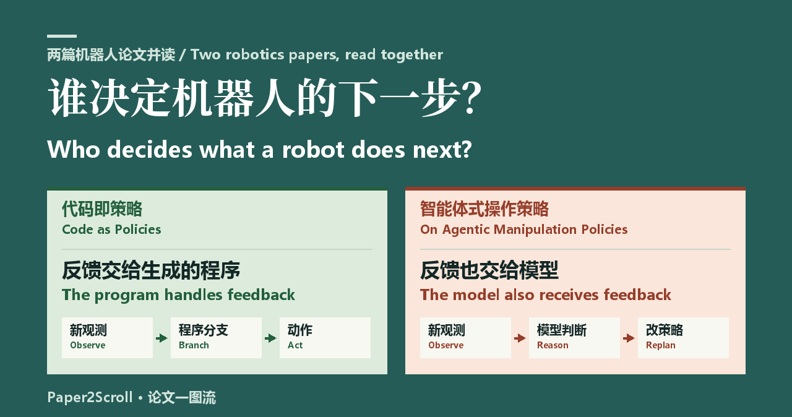

# Paper2Scroll · 论文一图流

**一张长图，读懂论文的主张、方法和证据。**

把研究论文 PDF 交给 Paper2Scroll，它会把核心主张、理论框架、研究方法和结果组织成一张纵向长图。关键结论标注原文章节、图号或表号，方便回查。

[English](README.md) · [看样例](#样例) · [安装](#安装)

- **每篇一张长图。** 三项导读搭起主线，随后展开方法、结果、关键对照和局限。
- **多篇一起读。** 保留逐篇长图，再按共同问题、证据异同生成 1–5 张综合图。
- **附论点证据表。** 回原文核对数字、比较条件和结论范围。

## 样例

**谁决定机器人的下一步？** 两篇公开论文分别展示了生成的程序如何根据观测作出反应，以及语言模型如何在执行中重新决定策略。

[](examples/robot-policies/feedback-synthesis.png)

| 公开论文 | 生成结果 |
| --- | --- |
| [Code as Policies: Language Model Programs for Embodied Control](https://arxiv.org/abs/2209.07753v4) | [独立长图](examples/robot-policies/code-as-policies.png) |
| [On Agentic Manipulation Policies](https://arxiv.org/abs/2611.09892v1) | [独立长图](examples/robot-policies/agentic-manipulation-policies.png) |
| 两篇并读：反馈交给谁？ | [综合长图](examples/robot-policies/feedback-synthesis.png) · [论点证据表](examples/robot-policies/evidence.md) |

## 安装

Paper2Scroll 是一个 [Agent Skill](https://agentskills.io/specification)，使用宿主提供的论文读取和图像渲染能力。以下命令以 Codex 项目为例，在项目根目录运行，确保上级目录可写。

```bash
git clone https://github.com/khuang9104/paper2scroll.git ../paper2scroll-source
mkdir -p .agents/skills
cp -R ../paper2scroll-source/skills/paper2scroll .agents/skills/
```

<details>
<summary>Windows PowerShell</summary>

```powershell
git clone https://github.com/khuang9104/paper2scroll.git ../paper2scroll-source
New-Item -ItemType Directory -Force -Path .agents/skills | Out-Null
Copy-Item -LiteralPath ../paper2scroll-source/skills/paper2scroll -Destination .agents/skills -Recurse
```

</details>

在项目里新开会话，附上论文，输入：

```text
用 $paper2scroll 帮我读这篇论文。画出方法和关键对照，并标出原文表号。
```

使用其他兼容 Agent Skills 的宿主时，将整个 [Skill 文件夹](skills/paper2scroll) 复制到该宿主的技能目录。导出 PNG 需要宿主有可用的渲染工具。

## 设置输出语言

编辑项目里的 `.agents/skills/paper2scroll/config.yaml`。[初始配置](skills/paper2scroll/config.yaml)是 `zh-en`。

```yaml
language: de
```

`zh` 是简体中文，`en` 是英文，`zh-en` 是中英双语。也可以填 `de`（德语）、`zh-Hant`（繁体中文）、`pt-BR`（巴西葡萄牙语）等标准语言标签。配置应用于长图、证据表和交付说明。本次请求明确指定语言时，以本次请求为准。

## 许可

[MIT](LICENSE) 适用于本项目和原创样例图。两篇论文通过原文链接查阅。
